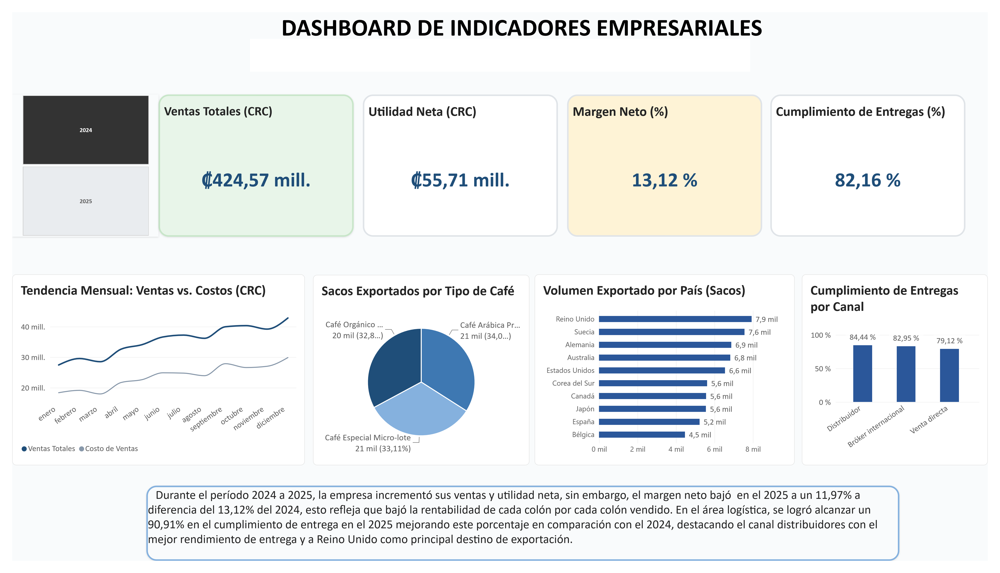

  <a href="README.md">English</a> | <a href="README.es.md"><strong>Español</strong></a>

# Dashboard de Indicadores Empresariales — Exportación de Café (Power BI + DAX)

Tablero ejecutivo de **Inteligencia de Negocios** para el seguimiento de rentabilidad comercial y cumplimiento logístico de una operación exportadora de café durante el período **2024–2025**.

---

## Vista del Dashboard

---

## Indicadores Clave (2024–2025)

| KPI | Resultado | Hallazgo |
|---|---|---|
| **Ventas Totales (CRC)** | **₡424.57 mill.** | Incremento sostenido de ingresos entre 2024 y 2025 |
| **Utilidad Neta (CRC)** | **₡55.71 mill.** | Crecimiento de utilidad neta en el período analizado |
| **Margen Neto (%)** | **13.12%** | El margen bajó a **11.97%** en 2025 frente al **13.12%** de 2024, reflejando menor rentabilidad por colón vendido |
| **Cumplimiento de Entregas (%)** | **82.16%** | Mejora logística importante al alcanzar **90.91%** en 2025 |

---

## Desglose del Análisis

- **Tendencia Mensual (Ventas vs. Costos):** Evolución mensual de enero a diciembre para detectar variaciones en rentabilidad.
- **Sacos Exportados por Tipo de Café:** Distribución equilibrada entre *Café Arábica* (21 mil, ~34.0%), *Café Especial Micro-lote* (21 mil, 33.11%) y *Café Orgánico* (20 mil, ~32.8%).
- **Volumen Exportado por País (Top 10):** Liderado por **Reino Unido (7.9 mil sacos)**, **Suecia (7.6 mil)** y **Alemania (6.9 mil)**.
- **Cumplimiento de Entregas por Canal:** **Distribuidor (84.44%)** supera a **Bróker internacional (82.95%)** y **Venta directa (79.12%)**.
