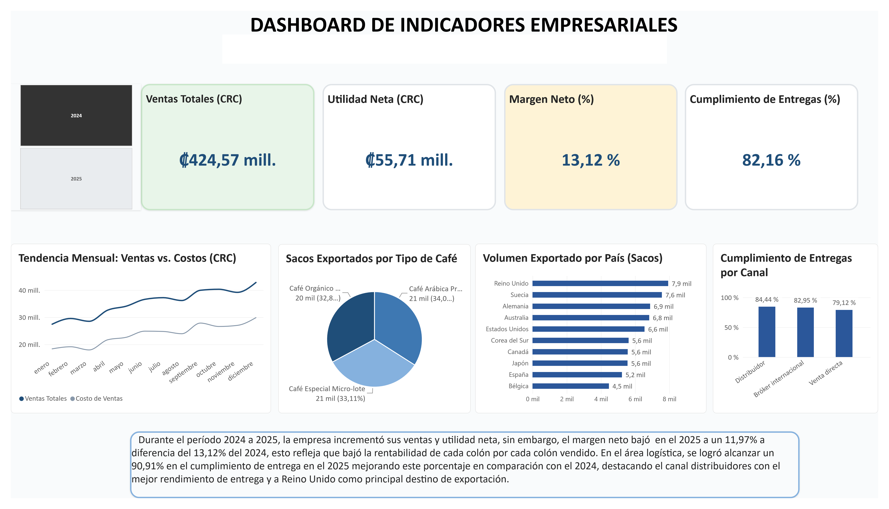

<div align="right">
  <a href="README.md"><strong>English</strong></a> | <a href="README.es.md">Español</a>
</div>

# Coffee Export Business KPI Dashboard (Power BI + DAX)

Executive **Business Intelligence** dashboard tracking commercial profitability and logistics delivery performance for a coffee export operation across **2024–2025**.

---

## Dashboard Preview



---

## Key Performance Indicators (2024–2025)

| KPI | Result | Insight |
|---|---|---|
| **Total Sales (CRC)** | **₡424.57M** | Overall revenue growth across the 2024–2025 period |
| **Net Profit (CRC)** | **₡55.71M** | Positive net profit growth alongside rising sales |
| **Net Margin (%)** | **13.12%** | Margin compressed to **11.97%** in 2025 vs. **13.12%** in 2024, signaling higher cost pressure per colón sold |
| **On-Time Delivery (%)** | **82.16%** | Logistics compliance improved significantly to **90.91%** in 2025 |

---

## Analytical Breakdown

- **Monthly Trend (Sales vs. Costs):** Tracks revenue and cost of goods sold from January to December to spot margin compression.
- **Volume by Coffee Type:** Balanced export mix across *Café Arábica* (21k bags, ~34.0%), *Café Especial Micro-lote* (21k bags, 33.11%), and *Café Orgánico* (20k bags, ~32.8%).
- **Top 10 Export Destinations:** Led by **United Kingdom (7.9k bags)**, **Sweden (7.6k)**, and **Germany (6.9k)**.
- **Delivery Compliance by Channel:** **Distributor (84.44%)** outperforms **International Broker (82.95%)** and **Direct Sales (79.12%)**.

---

## Technical Implementation

- **Power Query (ETL):** Data extraction, cleaning, type standardization, and relational table shaping.
- **DAX Measures:** Calculated KPIs for Total Sales, Net Profit, Net Margin %, Delivery Compliance %, and year-over-year comparisons (`2024` vs. `2025` slicer).

---

## Repository Structure

```text
├── Coffee_Export_KPI_Dashboard.pbix    # Power BI Desktop file
├── docs/
│   └── Coffee_Export_KPI_Dashboard.pdf # PDF export
└── assets/
    └── dashboard_overview.png          # High-resolution dashboard preview
```
